# airesdeornelas

- pe direito actual = 2.75m

# quartos - definicao do que é pretendido

## em comum nos dois quartos

- __tecto falso com 2.55m pe direito__
  - material do tecto falso:
    - placas de gesso cartonado hidrófugo (verdes)
    - estrutura de aço galvanizado
    - barramento com massas de base aquosa de baixa emissão, massas de juntas com certificação Classe E1 ou A+
  - colocacao de nova sanca
  
    [exemplo](https://www.leroymerlin.pt/produtos/sanca-homestar-s50-200x4x5cm-17914344.html):
    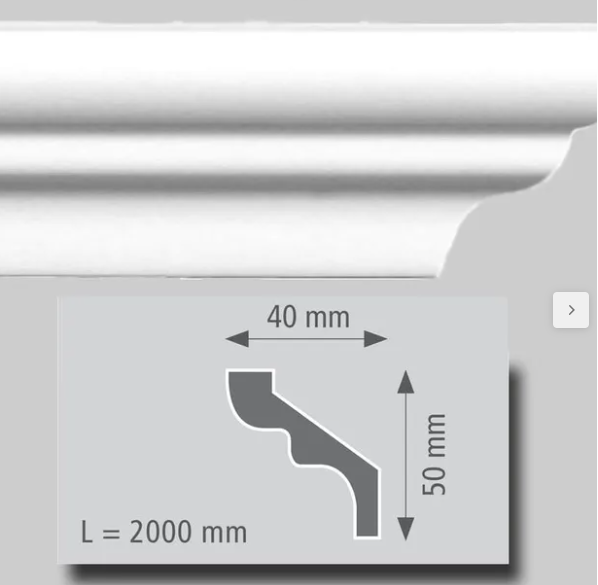
  - __o material da sanca deve ser ambientalmente seguro, sem emissoes de gases nocivos, pode ser__:
    - __poliestireno desde que tenha certificacao "Livre de CFC" e de solventes__
- __rodape__: 
  - [exemplo](https://www.leroymerlin.pt/produtos/rodape-200x6x1-3-cm-homestar-cf11-17098746.html):

    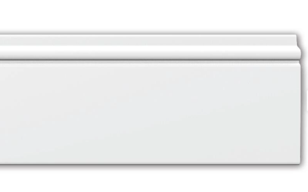
    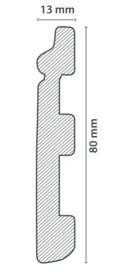
  - __o material deve ser ambientalmente seguro, sem emissoes de gases nocivos, pode ser__:
    - __poliestireno desde que tenha certificacao "Livre de CFC" e de solventes__
    - __composto de madeira e polimero: desde que utilize polimeros virgens ou reciclados de grau alimentar (PE ou PP), que são inertes e seguros__
- __isolamento termico (roofmate) do tecto__
- __isolamento termico (roofmate) da parede onde se encontra a janela__
- __ar condicionado__:
  - sistema split inverter - unidade interior (7-9 k btu) e respectiva unidade exterior
  - colocacao das unidades exteriores:
    - 1a sugestao

      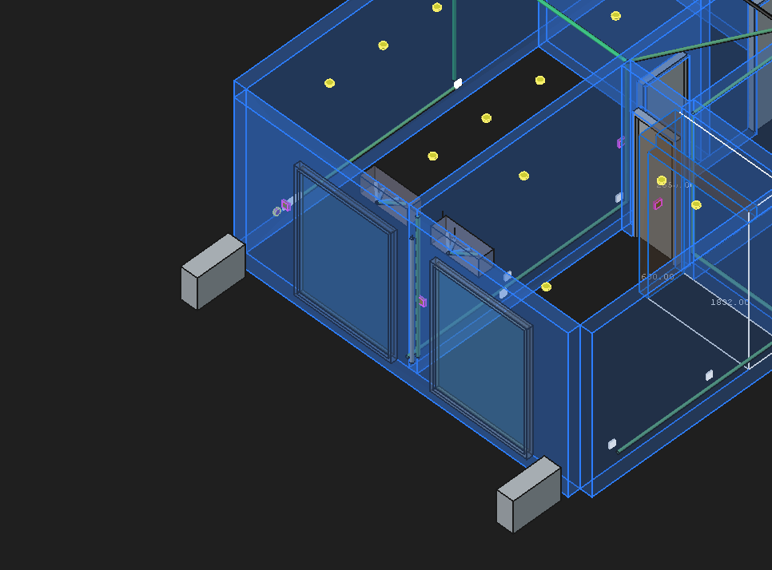
    - 2a sugestao

      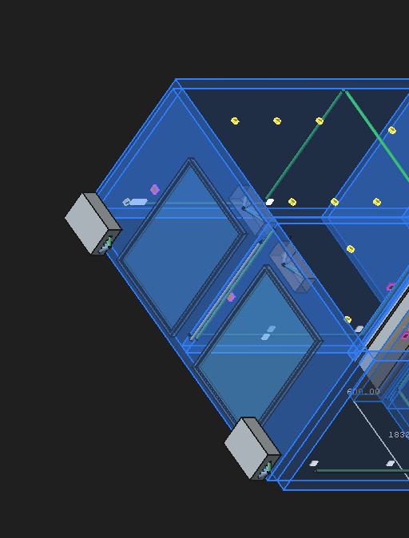


- __tubagem pelo tecto falso__: todas as ligacoes electricas e eventuais tubagens devem passar, na medida do possivel, pelo tecto falso
- __luzes led no tecto__
  - os focos devem ser encastrados com anéis de estanquidade para selar completamente o ar do teto falso
  - devem ter uma estetica discreta

    exemplo:
  
    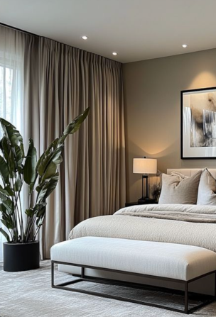

- __tomadas e interruptores__: localizacao em altura de tomadas e interruptores deve ser a comummente usada hoje em dia noutras obras (30cm: tomadas, 1m: interruptores, ...)
- __material electrico__
  - interruptores e tomadas, [exemplo](https://www.leroymerlin.pt/produtos/eletricidade-e-smart-home/interruptores-e-tomadas/series-de-interruptores-e-tomadas/serie-logus/):
  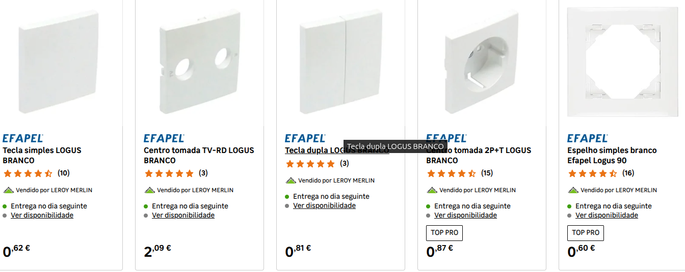

- __chão__: afagamento e envernizamento do chao de madeira
  - o verniz deve ser de base aquosa, satinado com proteccao UV, preferencialmente bicomponente (2K), com certificação EC1 Plus ou Greenguard Gold, que prove ter emissoes muito baixas (ha vernizes da marca Cin/Artilin com estas definicoes)
- __pintura__: paredes e tecto


## quarto de dormir
- __esquema geral__

  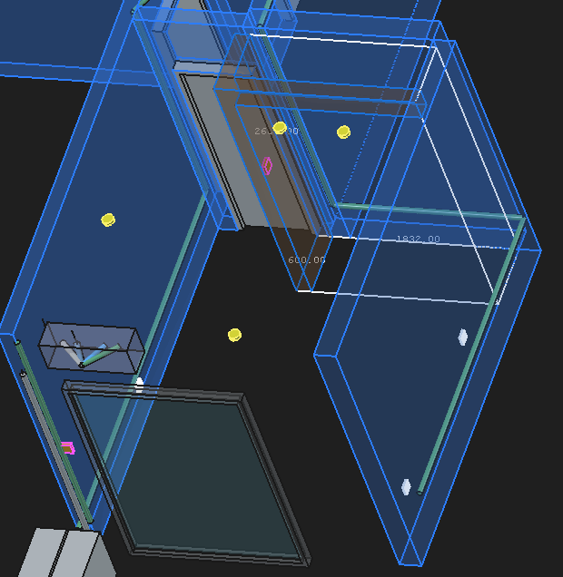
- __esquema de topo__

  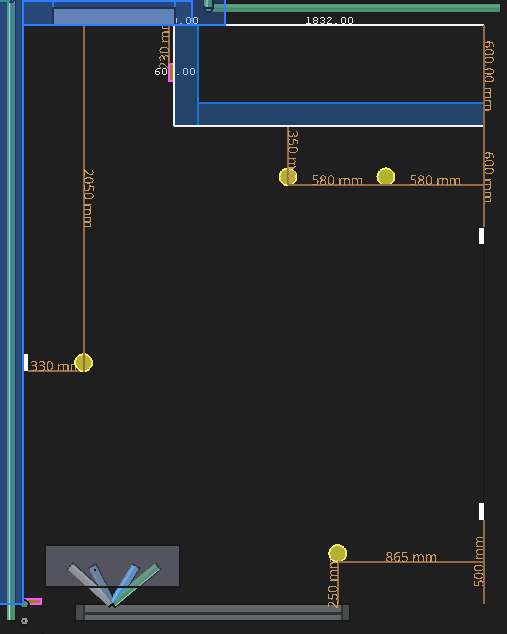

    - legenda:
      - amarelo: leds (4)
      - branco: tomadas (3)
      - rosa: interruptores (2)

- __iluminacao tecto em leds__
  - junto ao roupeiro (2): focos de recuo/angulo 60 (2/3 cm para dentro), temperatura 3000k, diametro 8cm, 7W, Índice de Reprodução de Cor (CRI) > 90
  - outros (2): cama: 2x focos de recuo/angulo 60 (2/3 cm para dentro), temperatura 2700k, diametro 8cm, 5W

- __armario__
  - levantamento de parede para armario (espessura 140 mm) a toda a altura do pe direito ate ao tecto falso com barra solida horizontal no topo (a azul e rebordo branco no esquema acima)

    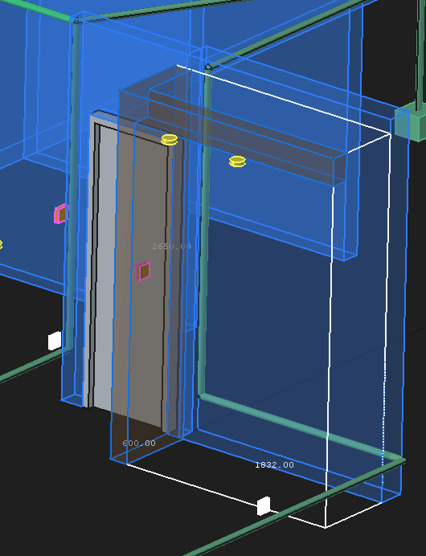
  - montagem de armario de 2 portas, em madeira, esquema exemplo:
  
    ```
    <----------------------- 180 cm (Total) ----------------------------->
                                                                    
    +---------------------------------+----------------------------------+  ^
    |                                 |                                  |  |
    |            MALEIRO              |            MALEIRO               |  | ~45cm
    | (Malas, Edredões, Sazonal)      | (Caixas de arrumação)            |  |
    |                                 |                                  |  v
    +-------------------+-------------+-------------------------+--------+  ^
    |                   |             |                         |        |  |
    |  VARÃO SUPERIOR   |             |       PRATELEIRAS       | PRAT.  |  |
    |      (45cm)       |             |       AJUSTÁVEIS        | AJUST. |  |
    | (Camisas/Blusas)  |             |       (Roupa            |        |  |
    |                   |             |        Dobrada)         |        |  |
    |                   |             |                         |        |  |
    +-------------------+ VARÃO LONGO +-------------------------+--------+  |
    |                   |    (45cm)   |                         |        |  | ~150cm
    |  VARÃO INFERIOR   | (Sobretudos,|       GAVETAS (2)       | GAVETAS|  |
    |      (45cm)       |  Vestidos)  |                         |  (2)   |  |
    | (Calças/Saias)    |             | (Roupa Interior, Meias, |        |  |
    |                   |             |Acessórios)              |        |  |
    |                   |             |         (60cm)          | (30cm) |  |
    +-------------------+-------------+-------------------------+--------+  v
    |                                 |                                  |  |
    |            GAVETA de REDE       |            GAVETA              	 |  | ~45cm
    |           (Sapatos)             |           (Arrumacao/Outros)     |  |
    |                                 |                                  |  |
    +---------------------------------+----------------------------------+  v
                                                                                                                                          
    <--------------------------------> <--------------------------------->
            VÃO ESQUERDO (90cm)              VÃO DIREITO (90cm)
            (Zona de Pendurar)               (Zona de Arrumação)
    ```
  - __notas a discutir__:

    - temos de dar 10cm de profundidade ao sistema de portas de correr, o que vai fazer recuar o espaco interior do armario para uma profundidade de 50cm
    - sera melhor criar uma barra inferior/rodape de armario, de parede, para servir de base onde colocar os sistema de calhas para que as portas nao batam nos pes? e o sistema de calhas para as portas vai estar ligado ao topo e a base do roupeiro? ou so ao topo?
    - as portas com esta altura vao ser pesadas, e podem empenar com o tempo, vi sugestoes de sistemas de calha superior com amortecimento (soft-close) em que os painéis das portas têm tensores internos ou perfis laterais de alumínio robustos.
  - exemplo (aproximado - so encontrei com 3 portas):

    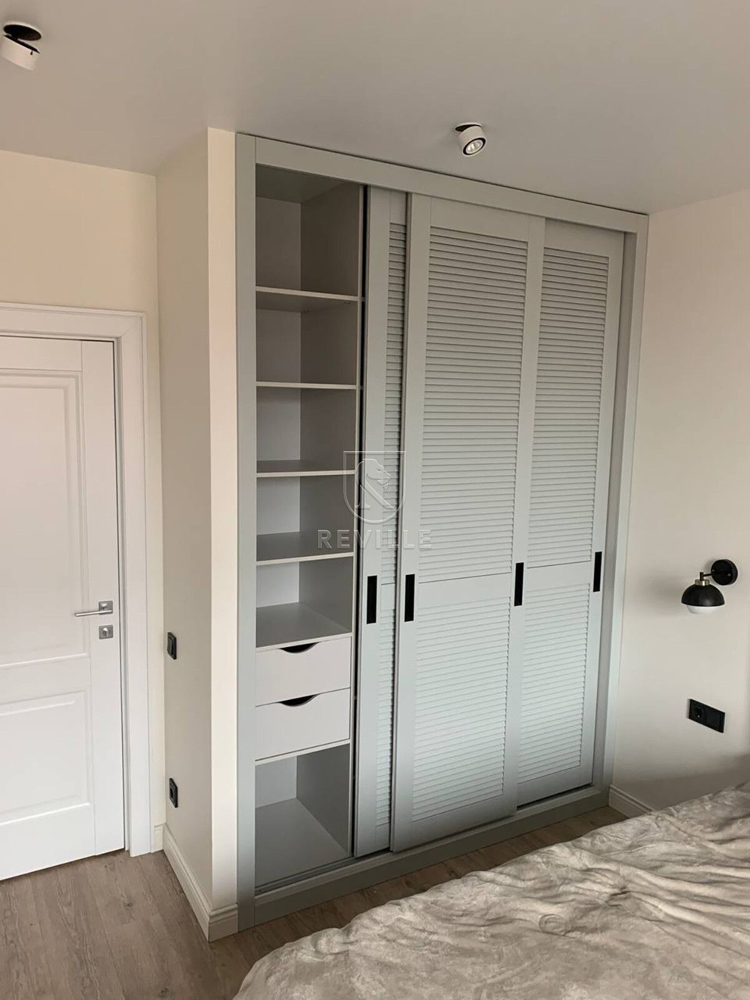

- __ombreira da porta de entrada no quarto__
  - lixamento, preparacao e pintura da parte interior da ombreira (do lado do quarto) até ao batente da porta
  - pintura com cor branca "casca-de-ovo" 
  - exemplo da area a ser tratada (aqui a verde):

    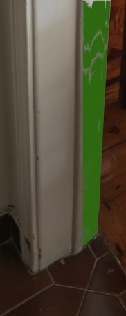


## quarto de escritorio

- __esquema geral__

  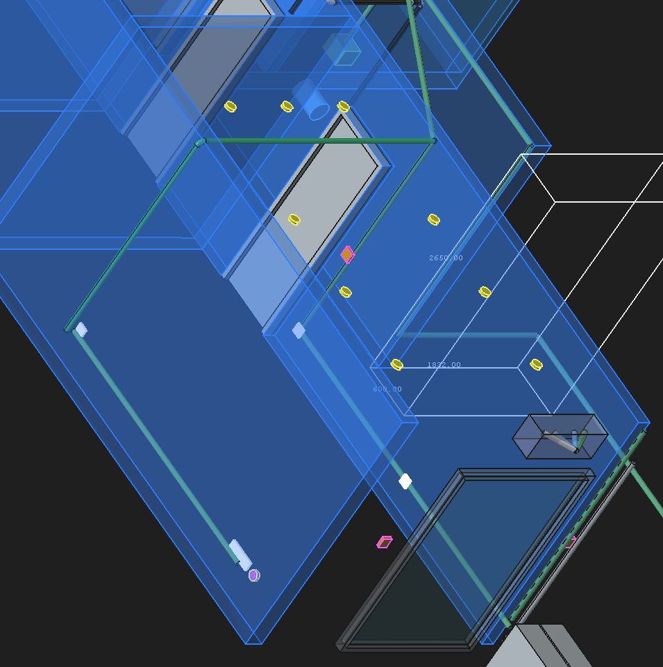

- __esquema de topo__

  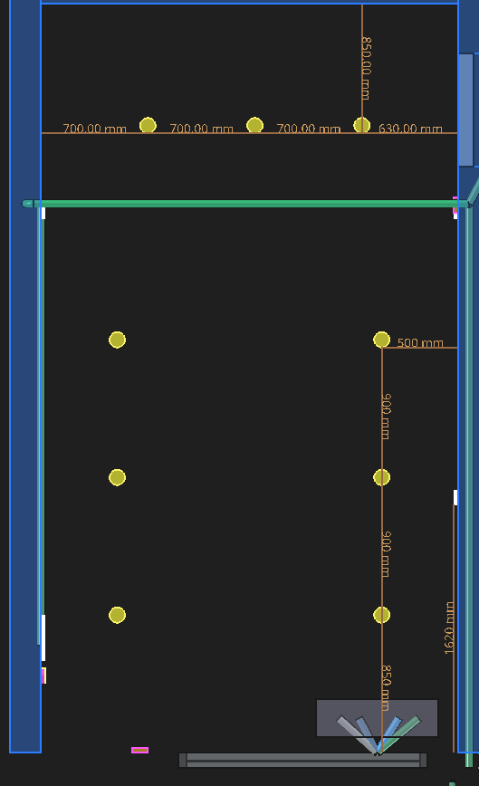

    - legenda:
      - amarelo: leds (9)
      - branco: tomadas (6)
      - rosa+amarelo: rj45 (1)
      - rosa: interruptores (2)

- __iluminacao tecto em leds__
  - junto a estante (3): focos de recuo/angulo 60 (2/3 cm para dentro), temperatura 2700k, diametro 8cm, 5W
  - junto as paredes (6): focos orientaveis de recuo/angulo 45 (2/3 cm para dentro), temperatura 3000k, diametro 8cm, 5W, Índice de Reprodução de Cor (CRI) > 90

- __ombreira da porta de entrada no quarto__
  - lixamento, preparacao e pintura da parte interior da ombreira (do lado do quarto) até ao batente da porta
  - pintura com cor branca "casca-de-ovo" 
  - exemplo da area a ser tratada (aqui a verde):

    


## trabalhos dependentes

- __redimensionamento do quadro electrico__ em consequencia das novas ligacoes (e a prever obras futuras)


